# AI Video Content Factory

[](https://www.python.org/downloads/)
[](LICENSE)
[](#system-requirements)
[](#project-status--roadmap)

**AI Video Content Factory** is an open modular system for automated, end-to-end video production. It transforms topics, ideas, or existing scripts into fully assembled, narrated videos with synchronized voiceover, animated scene visuals, ambient audio mixing, subtitles, and publishing metadata.

Designed to be **universal**, the factory supports multiple content formats and genres: **short vertical videos (9:16 Shorts/Reels/TikTok)**, **explainer videos (16:9)**, **tech & product reviews**, **educational documentaries**, and **immersive narratives**.

---

## 1. Problem Statement

Creating engaging narrated video content typically requires juggling multiple disjointed tools:
- Writing prompts and breaking scripts into timed scenes across LLMs.
- Exporting voiceovers from speech synthesizers and manually aligning them to text.
- Generating matching scene illustrations and maintaining visual continuity.
- Stitching footage in video editors, setting up Ken Burns motion, applying crossfades, and balancing loudness.
- Formatting subtitles and crafting YouTube metadata and chapter timestamps.

When any intermediate step fails or needs a minor edit, creators often have to redo hours of manual labor. **AI Video Content Factory** automates this entire chain into a deterministic, reproducible conveyor. If you interrupt a run or need to change a scene, the system resumes from the last completed stage without wasting API tokens or re-rendering unchanged media.

---

## 2. End-to-End Production Workflow

```mermaid
flowchart LR
    A["Topic / Script / Notes"] --> M1["M1: Script Engine\n(Structure, Chunks, Fact-check)"]
    M1 --> M2["M2: Speech & Audio\n(TTS Voiceover + Word Timings)"]
    M2 --> M3["M3: Visual Direction\n(Scene Plan + Prompting + Images)"]
    M3 --> M4["M4: Assembly & Montage\n(Ken Burns, Transitions, Subtitles)"]
    M4 --> M5["M5: Metadata Studio\n(Title, Tags, Chapters, Cover)"]
    M5 --> M6["M6: Distribution\n(YouTube API / Local Export)"]
    M6 --> B["Finished Master MP4\n+ Timecodes + SRT"]
```



1. **Input:** You provide a topic, target duration, language, and format (or your own custom script).
2. **M1 Script:** Breaks the narrative into structured chunks with drama criticism, pacing checks, and formatting.
3. **M2 Audio:** Synthesizes voiceover with speech-tag density, normalizes loudness, and derives word-level timestamps via Whisper STT.
4. **M3 Visuals:** Computes deterministic scene boundaries (snapped to natural speech pauses), maintains world lighting/palette constraints, and generates scene artwork.
5. **M4 Assembly:** Renders cinematic motion per scene (zoom in, pan, slow zoom), joins clips with smooth crossfades, masters ambient background music (-14 LUFS standard), and burns in subtitles.
6. **M5 Metadata:** Generates YouTube-ready titles, descriptions, SEO tags, chapter timecodes, and thumbnail artwork.
7. **M6 Publish:** Uploads via YouTube Data API v3 (or exports cleanly to an output folder).

---

## 3. Core Capabilities

- **Local-First & Offline Capable:** Run completely offline in test/mock mode or with local neural models (Silero TTS, local Stable Diffusion on GPU) without external fees.
- **BYOK (Bring Your Own Key):** Plug in any OpenAI-compatible LLM endpoint (OpenRouter, Groq, Together, custom endpoints), commercial TTS (Smallest.ai, ElevenLabs), or video models via `.env`.
- **Granular Checkpoints & Resume:** Every stage saves validated JSON contracts into SQLite (`state.db`) and disk. If interrupted, `pipeline resume <run_id>` resumes right where it stopped.
- **Cache & Budget Protection:** LLM and image calls are hashed and cached; strict budget caps (`budget_limit_usd`) stop runs before costly surprises.
- **Smart Pacing & Audio Snapping:** Scene cuts never happen mid-word; scene transition timestamps automatically snap to speech pauses detected by Whisper.
- **Dual Interface:** Accessible via both a streamlined **CLI** (`pipeline`) and a modern **Web Studio UI** (`pipeline ui`) with interactive storyboard, model selection, and progress monitoring.

---

## 4. Supported Genres & Formats

The factory does not hardcode content styles; it parameterizes them via `config/formats.yaml` and channel profiles:

| Format ID | Aspect Ratio | Resolution | Scene Pace | Typical Use Case |
|---|---|---|---|---|
| `short_vertical` | **9:16** | 1080x1920 | 3 – 7 sec | YouTube Shorts, TikTok, Instagram Reels with burned-in subtitles |
| `explainer` | **16:9** | 1920x1080 | 6 – 12 sec | Technical concepts, business explainers, educational overviews |
| `tech_review` | **16:9** | 1920x1080 | 5 – 10 sec | Hardware, software, gadget reviews and comparisons |
| `educational_narrative` | **16:9** | 1920x1080 | 12 – 25 sec | Science, nature, biography, and narrative non-fiction |
| `talking_head` | **16:9** | 1920x1080 | 8 – 15 sec | Commentary, dynamic monologues, presentations |
| `sleep_history` | **16:9** | 1920x1080 | 30 – 60 sec | Atmospheric, deep bedtime storytelling and relaxing lore |

---

## 5. Working vs. Experimental Features

### Fully Operational
- Full conveyor execution (M1 through M5) with real FFmpeg video and audio mastering.
- Deterministic dry-run mode (mocks all providers with synthetic media in seconds).
- SQLite state machine tracking step states (`pending`, `running`, `done`, `failed`).
- CLI interface (`doctor`, `run`, `status`, `resume`, `ui`).
- Multi-language interface (English, Russian, Spanish, German, Chinese, French, Arabic, and more).
- Procedural ambient synth & CC0 music auto-search (Openverse, Jamendo).
- Word-level subtitle generation (`.srt` and burned-in styling).
- Export to custom folders (`export_dir`) with chapter timecodes.

### Experimental / Hardware-Dependent
- **Local Stable Diffusion (FP16):** Requires NVIDIA GPU with >= 8 GB VRAM.
- **Local Voice Cloning (F5-TTS / Chatterbox):** Requires PyTorch CUDA setup and pretrained weights.
- **YouTube OAuth (M6):** Requires setting up a Google Cloud Desktop OAuth Client (`client_secret.json`).

---

## 6. System Requirements

### Minimum (Cloud / API Mode)
- **OS:** Windows 10/11, Ubuntu 22.04+, or macOS
- **Python:** 3.11 or newer
- **FFmpeg:** Installed and available on system `PATH`
- **RAM:** 8 GB
- **Disk:** 5 GB free disk space

### Recommended (Local Neural Generation Mode)
- **GPU:** NVIDIA GeForce RTX 3060 or better (8+ GB VRAM) with CUDA 12.1+
- **RAM:** 16 GB+
- **Disk:** 30 GB free SSD space (for model weights and caching)

---

## 7. Step-by-Step Installation

### Step 1: Clone the repository
```bash
git clone https://github.com/sursinges/AI-Video-Content-Factory.git
cd AI-Video-Content-Factory
```

### Step 2: Ensure FFmpeg is installed
Verify that FFmpeg is accessible:
```bash
ffmpeg -version
```
> **Windows Tip:** If missing, install via Windows Package Manager:
> ```powershell
> winget install Gyan.FFmpeg
> ```

### Step 3: Create Python virtual environment
```bash
python -m venv .venv

# On Windows:
.venv\Scripts\activate

# On Linux / macOS:
source .venv/bin/activate
```

### Step 4: Install dependencies
```bash
pip install -e pipeline
```

---

## 8. First Run & Health Check

### 1. Run the system diagnostics
The built-in `doctor` command verifies your Python version, FFmpeg binaries, GPU status, disk capacity, and configuration health:
```bash
python -m core.cli doctor
```
*(Or simply `pipeline doctor` if installed in your environment)*

### 2. Run a zero-cost dry-run
Test the full 6-stage conveyor using synthetic mock media without needing API keys or downloading heavy models:
```bash
python -m core.cli run examples/manifest_tech_explainer.yaml --dry-run
```

Check run status:
```bash
python -m core.cli status
```

### 3. Launch the Web Studio UI
Launch the interactive browser dashboard:
```bash
python -m core.cli ui --port 8765
```
Open your browser at **`http://localhost:8765`**.

---

## 9. Configuration & BYOK Setup

Copy the environment template to activate external API providers:
```bash
# In the pipeline directory:
cp config/ui_settings.example.yaml config/ui_settings.yaml
```

Set your API keys in `pipeline/.env` (which is excluded from Git tracking):
```env
# LLM Providers (OpenRouter, OpenAI-compatible)
OPENROUTER_API_KEY="sk-or-v1-..."

# Commercial TTS (Optional)
SMALLEST_AI_API_KEY="..."

# Music Library APIs (Optional)
JAMENDO_CLIENT_ID="..."
FREESOUND_TOKEN="..."
```

Review and adjust provider defaults in [`pipeline/config/providers.yaml`](pipeline/config/providers.yaml):
```yaml
defaults:
  llm: openrouter        # or mock
  tts: smallest_ai       # or silero, chatterbox, mock
  image: local_sd        # or vheer_browser, mock
  music: ambient_synth   # procedural ffmpeg synth (no keys needed)
  publish: mock_publish
```

---

## 10. Output Artifacts & Resuming Runs

All generated assets are stored under `pipeline/runs/<run_id>/`:
```
runs/ep-0001/
├── script/
│   └── script.json           # Chunked script with pacing metrics
├── audio/
│   ├── episode.wav           # Master voiceover track
│   └── speechplan.json       # Sentence & tag timings
├── subtitles/
│   ├── subtitles.json        # Word-level Whisper timestamps
│   └── subtitles.srt         # Standard SRT subtitle file
├── visual/
│   ├── world.json            # Visual palette & constraints
│   ├── scenes.json           # Timed scene plan & prompt references
│   └── assets/               # Rendered scene illustrations
├── video/
│   ├── episode.mp4           # Final mastered video
│   ├── timecodes.txt         # Formatted YouTube chapter timestamps
│   └── effects_report.json   # Log of camera movements applied
└── metadata/
    ├── metadata.json         # SEO title, description, and keywords
    └── thumbnail.png         # Cover thumbnail
```

If a run fails due to network outage or API rate-limit:
```bash
python -m core.cli resume ep-0001
```
The orchestrator skips already completed stages and resumes from the exact point of failure.

---

## 11. Troubleshooting Common Issues

| Symptom | Cause | Solution |
|---|---|---|
| `Pre-flight validation failed: FFmpeg binary not found` | FFmpeg is not installed or not in system `PATH` | Install FFmpeg and restart your terminal. |
| `CUDA out of memory` | Local Stable Diffusion model exceeds VRAM | Lower resolution in profile (`image_size: [768, 432]`) or use an external image provider. |
| `HTTP 429: Rate limited` | API provider quota reached | The router will automatically retry or fall back to secondary providers configured in `fallbacks:`. |
| `NameError` or missing modules when running tests | `pipeline` is not in Python path | Run tests with `pytest` from the repository root, which auto-loads the root `pyproject.toml`. |

---

## 12. Project Status & Roadmap

- [x] **Core Pipeline (S0–S4):** Deterministic contracts, audio synthesis, visual direction, FFmpeg montage.
- [x] **Metadata & Packaging (S5):** YouTube chapters, SEO descriptions, cover studio.
- [x] **Web Studio (UI):** Interactive storyboard, scene regeneration, timecode editing, phone remote.
- [x] **Diagnostics & Pre-flight:** Built-in `doctor` command and validation checks.
- [x] **Universal Formats:** 9:16 vertical shorts, explainers, tech reviews, and documentary presets.
- [ ] **Direct Image-to-Video Transitions:** Native Kling / Seedance video generation per hero scene.
- [ ] **Batch Series Production:** Automated queue for processing multi-episode playlists.
- [ ] **Cloud Packaging:** Optional headless Docker container for remote Linux rendering nodes.

---

## 13. Documentation & Links

- **Project Structure & Components:** [`pipeline/docs/PROJECT_STRUCTURE.md`](pipeline/docs/PROJECT_STRUCTURE.md)
- **Developer Recipes & Extensions:** [`pipeline/docs/RECIPES.md`](pipeline/docs/RECIPES.md)
- **Voice Guide & TTS Setup:** [`pipeline/docs/VOICE_GUIDE.md`](pipeline/docs/VOICE_GUIDE.md)
- **Community Plugins System:** [`pipeline/docs/COMMUNITY_PLUGINS.md`](pipeline/docs/COMMUNITY_PLUGINS.md)
- **Asset Creation Rules:** [`pipeline/config/ASSET_RULES.md`](pipeline/config/ASSET_RULES.md)

---

## 14. License

This project is licensed under the **MIT License**. See the [LICENSE](LICENSE) file for details.
Components that link to third-party models (e.g., Silero, Coqui XTTS, Stable Diffusion) adhere to their respective upstream licenses.
