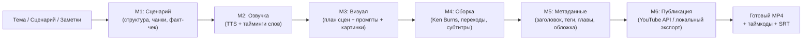

# AI Video Content Factory

[English](README.md) | **Русский** | [Español](README.es.md) | [Deutsch](README.de.md) | [Français](README.fr.md) | [Português](README.pt-BR.md) | [中文](README.zh-CN.md) | [日本語](README.ja.md) | [हिन्दी](README.hi.md) | [العربية](README.ar.md)

[](https://www.python.org/downloads/)
[](LICENSE)
[](#системные-требования)

**AI Video Content Factory** — открытая модульная система для автоматизированного сквозного производства видео. Превращает тему, идею или готовый сценарий в полностью собранный ролик с дикторской озвучкой, анимированными сценами, эмбиент-миксом, субтитрами и метаданными для публикации.

Система **универсальна**: поддерживает несколько форматов — **вертикальные shorts (9:16)**, **объясняющие видео (16:9)**, **обзоры техники**, **обучающие документалки** и **атмосферные нарративы**.

> Язык интерфейса: 10 языков (RU/EN/ES/ZH/HI/AR/PT/FR/DE/JA) — выбирается в самой студии.

---

## 1. Какую проблему решает

Создание озвученного видео обычно требует жонглирования разрозненными инструментами:
- Промпты и разбивка сценария на таймированные сцены в LLM.
- Экспорт озвучки из синтезаторов речи и ручная подгонка к тексту.
- Генерация иллюстраций сцен и удержание визуальной целостности.
- Сборка в видеоредакторе: Ken Burns, кроссфейды, балансировка громкости.
- Оформление субтитров и метаданных YouTube с таймкодами глав.

Если промежуточный шаг упал или нужна правка — часы ручной работы заново. **AI Video Content Factory** автоматизирует всю цепочку в детерминированный воспроизводимый конвейер: при сбое или правке сцены система продолжает с последнего завершённого этапа, не тратя токены и не перерендеривая неизменное.

---

## 2. Сквозной процесс



1. **Вход:** тема, длительность, язык и формат (или свой сценарий).
2. **M1 Сценарий:** структура с критикой драматургии, темпом и форматированием.
3. **M2 Озвучка:** синтез с тегами эмоций, нормализация громкости, пословные тайминги через Whisper.
4. **M3 Визуал:** детерминированные границы сцен (по речевым паузам), ограничения мира (палитра/свет), генерация кадров.
5. **M4 Сборка:** кинематографичное движение по сценам, кроссфейды, эмбиент-мастеринг (−14 LUFS), вшивание субтитров.
6. **M5 Метаданные:** заголовки, описания, SEO-теги, таймкоды глав, обложка.
7. **M6 Публикация:** YouTube Data API v3 (или экспорт в папку).

---

## 3. Ключевые возможности

- **Локальный запуск и оффлайн-режим:** полностью офлайн в mock-режиме или на локальных моделях (Silero TTS, локальный Stable Diffusion) — без внешних расходов.
- **BYOK:** подключите любой OpenAI-совместимый LLM (OpenRouter, Groq и др.), коммерческий TTS (Smallest.ai, ElevenLabs) или видео-модели через `.env`.
- **Чекпоинты и resume:** каждый этап сохраняет валидированный JSON-контракт в SQLite (`state.db`) и на диск; `pipeline resume <run_id>` продолжает с места остановки.
- **Кэш и бюджеты:** вызовы LLM/картинок кэшируются по хэшу; `budget_limit_usd` остановит прогон до дорогих сюрпризов.
- **Умный темп:** склейки не режут слова — границы сцен сходятся на речевых паузах по Whisper.
- **Два интерфейса:** CLI (`pipeline`) и Web Studio (`pipeline ui`) с интерактивной раскадровкой, выбором моделей и превью сцены плеером.

---

## 4. Форматы

Стили не зашиты в код — они параметризуются через `config/formats.yaml` и профили каналов:

| Формат | Соотношение | Разрешение | Темп сцен | Типичное применение |
|---|---|---|---|---|
| `short_vertical` | **9:16** | 1080x1920 | 3 – 7 сек | Shorts, TikTok, Reels с вшитыми субтитрами |
| `explainer` | **16:9** | 1920x1080 | 6 – 12 сек | Технические и бизнес-объяснения |
| `tech_review` | **16:9** | 1920x1080 | 5 – 10 сек | Обзоры железа, софта, гаджетов |
| `educational_narrative` | **16:9** | 1920x1080 | 12 – 25 сек | Наука, природа, биографии |
| `talking_head` | **16:9** | 1920x1080 | 8 – 15 сек | Комментарии, монологи, презентации |
| `long_narrative` | **16:9** | 1920x1080 | 30 – 60 сек | Спокойные атмосферные истории для фонового просмотра |

---

## 5. Готовое vs экспериментальное

### Работает
- Полный конвейер M1–M5 с реальным FFmpeg-мастерингом видео и аудио.
- Детерминированный dry-run (mock-провайдеры синтезируют медиа за секунды).
- SQLite state-машина статусов шагов (`pending`, `running`, `done`, `failed`).
- CLI (`doctor`, `run`, `status`, `resume`, `ui`).
- Интерфейс на 10 языках.
- Процедурный эмбиент и CC0-музыка (Openverse, Jamendo).
- Пословные субтитры (`.srt` и вшивание стилями).
- Экспорт в свою папку (`export_dir`) с таймкодами глав.
- Image→video по сценам (Kling через fal_video; live — с ключом `FAL_KEY`, тесты — на mock).
- Превью сцены плеером прямо в раскадровке.

### Экспериментальное / зависит от железа
- **Локальный Stable Diffusion (FP16):** NVIDIA GPU с >= 8 ГБ VRAM.
- **Локальное клонирование голоса (F5-TTS / Chatterbox):** PyTorch CUDA и веса моделей.
- **YouTube OAuth (M6):** Google Cloud OAuth Client (`client_secret.json`).

---

## 6. Издания: Desktop и Web (Cloud)

Одна кодовая база, два издания (подробности — [`pipeline/docs/EDITIONS.md`](pipeline/docs/EDITIONS.md)):

| | **Desktop** (Community, по умолчанию) | **Web** (Cloud) |
|---|---|---|
| Пользователи | один владелец, без входа | multi-tenant, вход по аккаунту |
| Данные | общий workspace | изолированные данные + BYOK на тенанта |
| Биллинг | — | кредиты за прогон, авто-возврат при ошибке |
| Очередь / квоты | — | очередь прогонов, дисковые квоты |
| Локальные GPU-модели | first-class (`pip install pipeline[desktop]`) | опционально |
| Установка | `pip install pipeline[desktop]` → `pipeline ui` | базовые зависимости + `edition: web`, `hosted_mode: true` в `config/ui_settings.yaml` |

Издание определяется из `PIPELINE_EDITION` → `ui_settings.yaml` → по умолчанию **desktop**; `pipeline doctor` его показывает.

---

## 7. Системные требования

### Минимум (облачный / API-режим)
- **ОС:** Windows 10/11, Ubuntu 22.04+, macOS
- **Python:** 3.11+
- **FFmpeg:** установлен и доступен в `PATH`
- **RAM:** 8 ГБ
- **Диск:** 5 ГБ

### Рекомендуется (локальная генерация)
- **GPU:** NVIDIA RTX 3060+ (8+ ГБ VRAM), CUDA 12.1+
- **RAM:** 16 ГБ+
- **Диск:** 30 ГБ SSD (модели и кэш)

---

## 8. Установка по шагам

### Шаг 1: Клонируй репозиторий
```bash
git clone https://github.com/sursinges/AI-Video-Content-Factory.git
cd AI-Video-Content-Factory
```

### Шаг 2: Проверь FFmpeg
```bash
ffmpeg -version
```
> **Windows:** если нет — `winget install Gyan.FFmpeg`

### Шаг 3: Виртуальное окружение
```bash
python -m venv .venv

# Windows:
.venv\Scripts\activate

# Linux / macOS:
source .venv/bin/activate
```

### Шаг 4: Зависимости
```bash
pip install -e pipeline
```

---

## 9. Первый запуск и проверка

### 1. Диагностика
```bash
python -m core.cli doctor
```

### 2. Бесплатный dry-run
Полный 6-этапный конвейер на mock-медиа — без ключей и загрузки моделей:
```bash
python -m core.cli run examples/manifest_tech_explainer.yaml --dry-run
python -m core.cli status
```

### 3. Web Studio
```bash
python -m core.cli ui --port 8765
```
Открой **`http://localhost:8765`**.

---

## 10. Конфигурация и BYOK

```bash
# В папке pipeline:
cp config/ui_settings.example.yaml config/ui_settings.yaml
```

Ключи — в `pipeline/.env` (исключён из git):
```env
OPENROUTER_API_KEY="sk-or-v1-..."
SMALLEST_AI_API_KEY="..."
JAMENDO_CLIENT_ID="..."
FREESOUND_TOKEN="..."
```

Дефолты провайдеров — в [`pipeline/config/providers.yaml`](pipeline/config/providers.yaml):
```yaml
defaults:
  llm: openrouter        # или mock
  tts: smallest_ai       # или silero, chatterbox, voice_studio, mock
  image: local_sd        # или vheer_browser, mock
  music: ambient_synth   # процедурный синтез ffmpeg (без ключей)
  publish: mock_publish
```

---

## 11. Артефакты и resume

Всё складывается в `pipeline/runs/<run_id>/`:
```
runs/ep-0001/
├── script/script.json           # Сценарий чанками с метриками темпа
├── audio/
│   ├── episode.wav              # Мастер-дорожка озвучки
│   └── speechplan.json          # Тайминги фраз и тегов
├── subtitles/
│   ├── subtitles.json           # Пословные тайминги Whisper
│   └── subtitles.srt            # Стандартный SRT
├── visual/
│   ├── world.json               # Палитра и ограничения мира
│   ├── scenes.json              # Таймированный план сцен
│   └── assets/                  # Кадры сцен
├── video/
│   ├── episode.mp4              # Финальное видео
│   ├── timecodes.txt            # Таймкоды глав для YouTube
│   └── effects_report.json      # Лог применённых движений камеры
└── metadata/
    ├── metadata.json            # SEO-заголовок, описание, теги
    └── thumbnail.png            # Обложка
```

Если прогон упал из-за сети или rate-limit:
```bash
python -m core.cli resume ep-0001
```
Оркестратор пропустит завершённые этапы и продолжит с точки сбоя.

---

## 12. Частые проблемы

| Симптом | Причина | Решение |
|---|---|---|
| `Pre-flight validation failed: FFmpeg binary not found` | FFmpeg не установлен или не в `PATH` | Установи FFmpeg и перезапусти терминал. |
| `CUDA out of memory` | Локальный SD не влезает в VRAM | Снизь разрешение в профиле (`image_size: [768, 432]`) или используй внешний image-провайдер. |
| `HTTP 429: Rate limited` | Квота провайдера | Роутер автоматически ретраит или падает на фоллбэк из `fallbacks:`. |
| `NameError` при запуске тестов | pipeline вне Python path | Запускай `pytest` из корня репозитория. |

---

## 13. Статус и roadmap

- [x] **Ядро конвейера (S0–S4):** детерминированные контракты, аудио, визуал, FFmpeg-монтаж.
- [x] **Метаданные (S5):** главы YouTube, SEO, студия обложек.
- [x] **Web Studio:** интерактивная раскадровка, регенерация сцен, таймкоды, удалённый доступ с телефона.
- [x] **Диагностика:** команда `doctor` и pre-flight проверки.
- [x] **Универсальные форматы:** вертикальные shorts, объясняющие, обзоры, документальные пресеты.
- [x] **Image→Video (GAP-01):** Kling через fal_video по сценам (`visual.video_scenes`); live — с `FAL_KEY`.
- [x] **Упаковка для облака:** Dockerfile (web) + systemd/Caddy инсталлер для Linux.
- [ ] **Пакетное производство серий:** очередь для многосерийных плейлистов.

---

## 14. Документация

- **Структура проекта:** [`pipeline/docs/PROJECT_STRUCTURE.md`](pipeline/docs/PROJECT_STRUCTURE.md)
- **Издания (Desktop / Web):** [`pipeline/docs/EDITIONS.md`](pipeline/docs/EDITIONS.md)
- **Рецепты для разработчиков:** [`pipeline/docs/RECIPES.md`](pipeline/docs/RECIPES.md)
- **Голосовой гайд:** [`pipeline/docs/VOICE_GUIDE.md`](pipeline/docs/VOICE_GUIDE.md)
- **Плагины сообщества:** [`pipeline/docs/COMMUNITY_PLUGINS.md`](pipeline/docs/COMMUNITY_PLUGINS.md)
- **Правила ассетов:** [`pipeline/config/ASSET_RULES.md`](pipeline/config/ASSET_RULES.md)

---

## 15. Лицензия

Проект распространяется по лицензии **MIT** (см. [LICENSE](LICENSE)). Компоненты, связанные со сторонними моделями (Silero, Coqui XTTS, Stable Diffusion), подчиняются лицензиям соответствующих апстримов.
